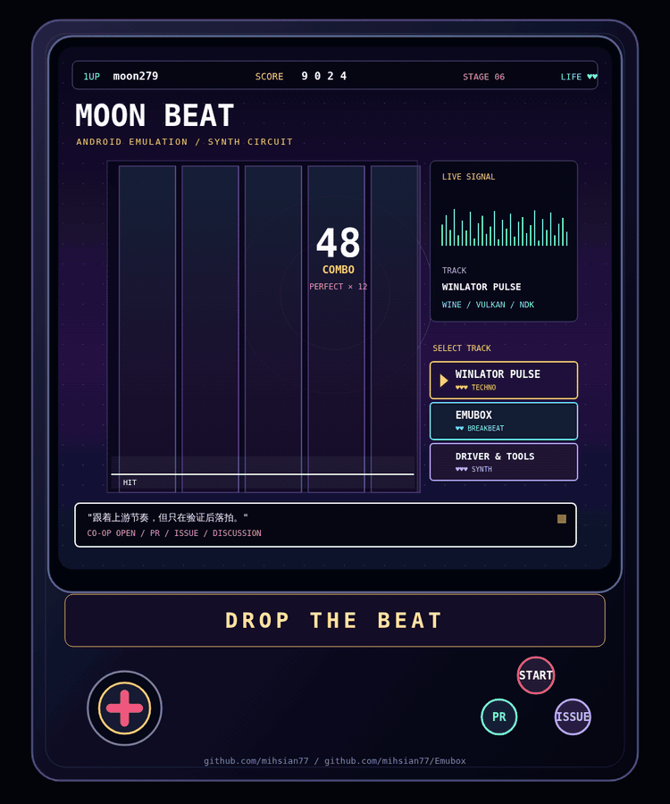

  <picture>
    <source media="(max-width: 640px)" srcset="assets/profile-arcade-mobile.gif">
    
  </picture>

  
  
  

  业余时间在折腾 Winlator / Wine 安卓生态：多版本容器、驱动、汉化和工具链。能复现的问题优先看，欢迎 PR、Issue 或交流。

## Driver & Tools / 上游观察

这里不是“又一个大而全的工具箱”，而是把上游驱动、运行库和工具的变化看明白，留下能对照、能复现的记录。重点在 Winlator / Wine 安卓生态里真正会用到的部分：驱动、DXVK、Turnip、Box64、汉化和构建工具链。

看得多，写得慢。没验证过的东西不往上堆。

## Open to co-op

- **兼容性问题**：带上设备、驱动、容器配置和日志，能复现就先从日志看起。
- **驱动 / 汉化 / 工具链**：有明确的参考项目或上游提交，欢迎直接开 Issue。
- **一起整理上游变化**：比起泛泛的“求整合”，更欢迎具体到某个组件、某次变更的讨论。

  <a href="https://github.com/mihsian77/Emubox/issues">Issue</a>
  ·
  <a href="https://github.com/mihsian77/Emubox/pulls">Pull Request</a>
  ·
  <a href="https://github.com/mihsian77/Emubox">Emubox</a>

## Loadout

  <code>C · Kotlin · Java · Python · Shell · JavaScript</code> 
  <code>Android · Linux · Wine · Vulkan · Android NDK · GitHub Actions</code>

  MOON BEAT · github.com/mihsian77

